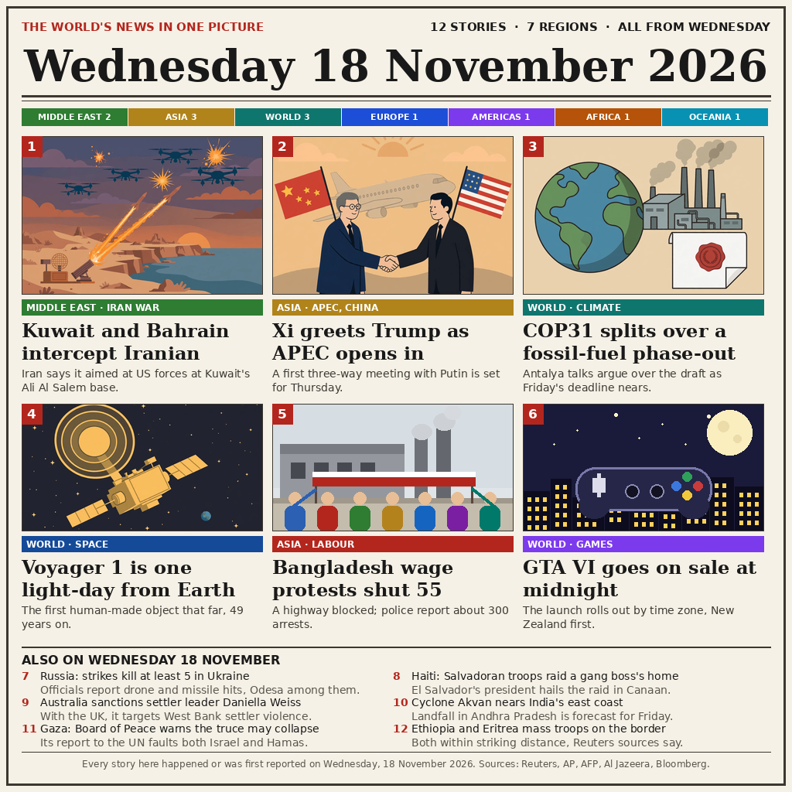

# Wednesday 18 November 2026 — The World's News in One Picture

One image summing up the world's news of Wednesday 18 November 2026.
Six illustrated stories, each with its own picture and a short headline:

1. Kuwait and Bahrain intercept Iranian drones (Middle East)
2. Xi greets Trump as APEC opens in Shenzhen (Asia)
3. COP31 splits over a fossil-fuel phase-out (World)
4. Voyager 1 is one light-day from Earth (World)
5. Bangladesh wage protests shut 55 factories (Asia)
6. GTA VI goes on sale at midnight (World)

Plus six briefs from the same day (Russia, Haiti, Australia, Cyclone
Akvan, Gaza, Ethiopia/Eritrea).

`main.py` (Python 3.13, standard library only) copies `entry.png` to
`/output/entry.png`. Run it twice and both runs write identical bytes.
